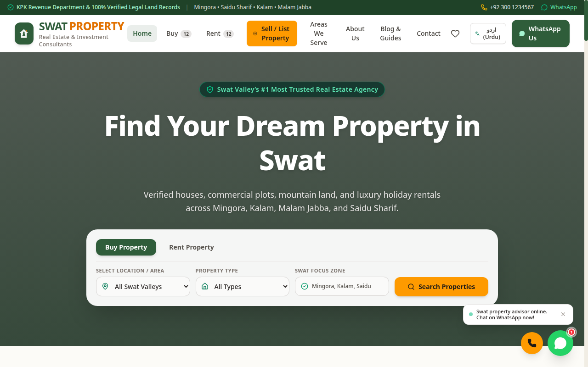

# Swat Property — Real Estate Portal for Swat Valley

A modern real estate portal for buying, selling, and renting property in **Swat Valley, Pakistan**. Browse verified listings for houses, plots, land, shops, and flats across Mingora, Saidu Sharif, Kalam, Malam Jabba, and more — with detailed area guides, price insights, and direct contact options.



## Features

- **Property listings** — houses, plots, land, shops, and flats for sale and rent
- **Advanced search & filters** — filter by area, type, purpose, price, and size
- **Property detail pages** — photo gallery with lightbox, features, and location info
- **Area guides** — dedicated pages for 10 Swat areas (Mingora, Saidu Sharif, Kalam, Malam Jabba, Fizagat, Madyan, Bahrain, Kabal, Matta, Charbagh) with price ranges and highlights
- **Favorites** — save listings and view them anytime
- **Mortgage calculator** — estimate monthly payments instantly
- **Sell your property** — submission page for owners
- **Bilingual** — full English / Urdu (اردو) language toggle
- **Blog, FAQs & testimonials** — buying guides and local market insights
- **Direct contact** — WhatsApp/call floating actions on every listing

## Tech Stack

- **React 19** + **TypeScript**
- **Vite** (build tool)
- **Tailwind CSS 4** (styling)
- **Lucide React** (icons)
- **Motion** (animations)

## Run Locally

**Prerequisites:** Node.js

1. Install dependencies:
   ```
   npm install
   ```
2. Start the development server:
   ```
   npm run dev
   ```
   The app runs on `http://localhost:3000`.

3. Build for production:
   ```
   npm run build
   ```

## Project Structure

```
src/
├── components/   # Navbar, Footer, PropertyCard, filters, mortgage calculator, lightbox
├── context/      # Language (EN/UR) and Favorites state
├── data/         # Listings, areas, blogs, FAQs, testimonials
├── pages/        # Home, Catalog, Property Detail, Sell, Areas, Blog, Contact, FAQ
├── types/        # TypeScript types
└── utils/        # Property helpers
```

## License

This project is for demonstration and local business use in Swat Valley.
